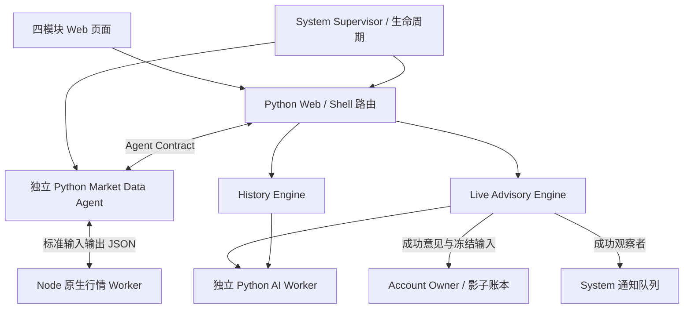

# 当前架构核查补充

CURRENT · 2026-10-11。本文件补充而不覆盖已锁定的 [ARCHITECTURE](ARCHITECTURE.md)、[DATA_OWNERSHIP](DATA_OWNERSHIP.md)、[CONTRACTS](CONTRACTS.md)。依据为实际源码静态阅读及 STEP04-FIX 测试记录；本轮不启动正式服务。

## 进程与组合（CURRENT）

Web 使用 Python 标准库 ThreadingHTTPServer；[trading_lab.py](../trading_lab.py) 为启动/验证入口，[bootstrap.py](../app/shell/bootstrap.py) 是唯一组合根，[server.py](../app/shell/server.py) 注册模块路由与健康/本机控制边界。浏览器只经 API 访问 Owner，不拥有业务库连接。

生产管理模式由 [runtime_control.py](../app/system/runtime_control.py) 的独立 Supervisor 管理 Web/Agent；Listener 意图持久化，但实时资格和循环属于 Live。Supervisor 不连接账户/行情数据库，不把“启动成功”解释成市场分析资格成立。Windows 桌面入口历史见 [WINDOWS_ENTRIES](WINDOWS_ENTRIES.md)。

两类 Worker 必须分清：[market_agent/service.py](../engines/live/market_agent/service.py) 启动 Node `worker.mjs` 做行情原生计算；[adapters/ai/transport.py](../adapters/ai/transport.py) 启动隔离 Python `worker.py` 调 Provider。都不是另一个 Share 服务。DEV 和新 Portable TEST 使用独立控制包装器与 Job 归属，不用 USER Supervisor 控制 DEV。见 [tools/dev/control.py](../tools/dev/control.py)、[portable_test_control.py](../portable-work/portable_test_control.py)。

## 所有权、事实与一致性（CURRENT）

| Owner | 事实 / Runtime | 实现与不变量 |
|---|---|---|
| Agent | Snapshot/Observation/Event；Session/checkpoint/运行描述 | [repository.py](../engines/live/market_agent/repository.py) 与 [service.py](../engines/live/market_agent/service.py)；独立根、单 Owner、Web 走 Contract |
| Live | `data/live/advisory` 不可变输入/Opinion；`data/runtime/live/advisory` 请求/水位 | [advisory_repository.py](../engines/live/advisory_repository.py)；成功、消费、阅读等身份不混用，不能把 Runtime 全清零 |
| History | `data/live/history` 工作缓存、任务、短期结果索引 | [store.py](../engines/history/store.py)；截止过滤、引用原 Opinion、上海自然日 TTL，无实时账户通知写权限 |
| Account | `data/account/unified` 控制库与各账户账本/投影 | [ledger.py](../engines/account/ledger.py) 的 BEGIN IMMEDIATE、哈希链和禁止更新/删除触发器；[control.py](../engines/account/control.py) 管绑定/状态版本，提交再验证 |
| System | 来源/AI配置、维护、通知结果和队列、运行意图 | [notifications.py](../app/system/notifications.py)、[runtime_state.py](../app/system/runtime_state.py)；网络投递不加入账户事务，未知结果不自动重发 |

上述路径是产品逻辑布局；DEV/TEST 映射到隔离根。正式 Agent 数据根来自本机来源配置，本轮不披露具体账户或读取生产内容。

跨 Owner 只传值型 Contract，不传任意路径/数据库连接。维护由 Owner 按租约、任务及引用保护执行。账户删除先解除绑定与禁止写入，再清理该账户独有文件；公共行情、Opinion、通知不随账户一起删。来源：[CONTRACTS](CONTRACTS.md)、[USER_PORTFOLIOS_7_11](USER_PORTFOLIOS_7_11.md)。

## 退役线与文档适用性（DEPRECATED / HISTORICAL）

旧 ADR、Foundation/Replay、ACK/Receipt 资料保留为 HISTORICAL。旧字词在 Schema 或原生身份恢复代码中存在，不授予旧产品路由和业务执行能力。四模块之外旧产品 404 以 [test_product_convergence.py](../tests/test_product_convergence.py) 为依据。

部分历史文档仍指向未公开的生产切换报告或旧集成目录；不能按旧步骤重新切源或执行提取。缺失项见 [KNOWLEDGE_SOURCES](KNOWLEDGE_SOURCES.md) 与 [HANDOFF_CURRENT](HANDOFF_CURRENT.md)。
